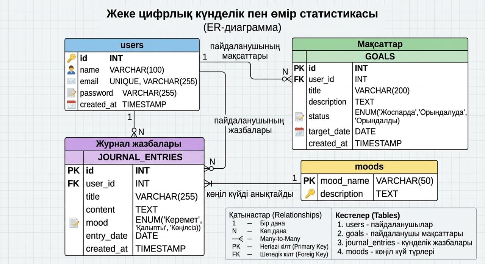

# Digital Twin ✦

## Жоба туралы

Digital Twin — күнделікті жоспарларды, жеке жазбаларды, мақсаттар мен жетістіктерді бақылауға арналған веб-қосымша.

## Жобаның мақсаты

Пайдаланушыға өз уақытын тиімді жоспарлауға, күнделікті оқиғаларын жазуға және жеке нәтижелерін бақылауға көмектесу.

## Қолданылатын технологиялар

- HTML
- CSS
- JavaScript
- PHP
- MySQL
- Git және GitHub

## Негізгі мүмкіндіктері

- Жобаның басты беті
- Пайдаланушының кіру беті
- Жеке күнделік пен статистика
- Күнделікті жазбаларды қосу
- Деректерді MySQL дерекқорында сақтау

## Жоба беттері

1. `index.php` — басты бет
2. `login.php` — кіру беті
3. `dashboard.php` — жеке статистика
4. `journal.php` — күнделік

## Автор

Студенттің жеке жобасы.

